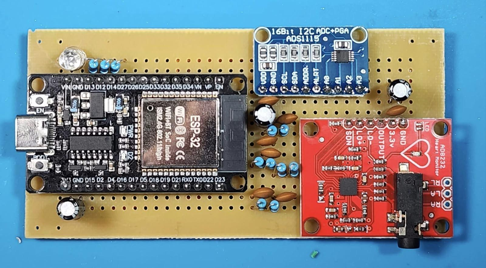

# PICMED UNICEPLAC

Sistema experimental de aquisição de eletrocardiograma (ECG) e análise de variabilidade da frequência cardíaca (VFC), desenvolvido para apoiar pesquisas no UNICEPLAC. O projeto reúne uma placa com ESP32, AD8232 e ADS1115 e uma aplicação Python com interface web, armazenamento local e geração de relatórios.

A proposta é manter o acesso às amostras brutas de ECG para permitir a revisão do sinal e a análise dos intervalos entre batimentos. O software calcula SDNN, RMSSD, pNN50 e o Índice de Estresse de Baevsky (SI), além de reunir questionários utilizados no estudo sobre estresse em acadêmicos de medicina.



*Placa de montagem do protótipo. Fotografia dos autores, extraída do relato de desenvolvimento do projeto.*

## O que o sistema faz

- Exibe o ECG e uma estimativa de frequência cardíaca durante a aquisição.
- Cadastra participantes por código e organiza as coletas em sessões.
- Armazena amostras brutas, questionários e resultados em SQLite.
- Processa o ECG com NeuroKit2 e calcula as métricas de VFC.
- Aplica PSS-10, IPAQ, PSQI e as versões reduzidas STAI-S-6 e STAI-T-6.
- Gera relatórios em PDF com os resultados e um trecho do sinal adquirido.

Esta versão utiliza uma interface web servida pelo Flask. A comunicação com a placa ocorre pela porta USB serial do computador que executa a aplicação.

## Hardware

| Componente | Função |
|---|---|
| ESP32 | Controla a aquisição e transmite as amostras por USB serial. |
| AD8232 | Condiciona o sinal dos eletrodos e informa sua desconexão. |
| ADS1115 | Digitaliza o sinal com resolução nominal de 16 bits, configurado para 250 amostras por segundo. |
| Filtros analógicos externos | Integram a montagem documentada, com notch Twin-T e passa-baixa. |

O ADS1115 comunica-se com o ESP32 por I2C. A transmissão para o computador utiliza pacotes binários de cinco bytes a 115200 baud.

Há duas variantes de firmware, com pinagens diferentes para o LED RGB. O esquema do protótipo corresponde aos pinos da variante `firmware_ecg2.ino`. Consulte as [fotos, o esquema e as conexões do hardware](docs/hardware.md) e a [orientação para gravar o firmware](firmware/README.md) antes da montagem.

## Instalação

É necessário ter Python 3.10 ou superior e acesso à porta serial do ESP32. As dependências Python estão em [requirements.txt](requirements.txt); o SQLite faz parte da biblioteca padrão do Python.

### Preparar o ambiente Python

```bash
git clone https://github.com/vituxdxd/picmed.git
cd picmed
python3 -m venv .venv
```

Ative o ambiente no Linux ou macOS:

```bash
source .venv/bin/activate
```

No Windows, use o PowerShell. Se o executável instalado se chamar `python`, use esse nome no lugar de `python3` nos comandos anteriores.

```powershell
.\.venv\Scripts\Activate.ps1
```

Instale as dependências com o ambiente ativo:

```bash
python -m pip install -r requirements.txt
```

### Habilitar os relatórios em PDF

A exportação exige Pandoc e XeLaTeX instalados no computador. No Ubuntu ou Debian:

```bash
sudo apt-get update
sudo apt-get install -y pandoc texlive-xetex
```

No Windows:

```powershell
winget install --id JohnMacFarlane.Pandoc -e
winget install --id MiKTeX.MiKTeX -e
```

Após instalar o MiKTeX, abra o MiKTeX Console, aplique as atualizações e habilite a instalação de pacotes adicionais quando solicitada. Reinicie o terminal e confira se as ferramentas estão disponíveis:

```bash
pandoc --version
xelatex --version
```

### Iniciar a aplicação

Na raiz do projeto, com o ambiente virtual ativo:

```bash
python app.py
```

Abra [http://localhost:5000](http://localhost:5000) no navegador. O banco `estudo_picmed.db` é criado no diretório de execução; inicie sempre pela raiz do projeto para utilizar o mesmo arquivo de dados.

## Realizar uma coleta

1. Grave o firmware correspondente à montagem e conecte o ESP32 ao computador com um cabo USB de dados.
2. Na interface, selecione a porta serial e conecte a placa. Feche o monitor serial da Arduino IDE se ele estiver usando a mesma porta.
3. Cadastre ou selecione o participante e defina a duração da coleta.
4. Verifique o estado dos eletrodos e acompanhe o traçado antes de iniciar o registro.
5. Inicie a aquisição e aguarde seu encerramento, ou interrompa pela interface quando necessário.
6. Preencha os questionários da sessão e solicite o processamento na lista de sessões encerradas.
7. Consulte os resultados e exporte o PDF, se as dependências de relatório estiverem instaladas.

Mantenha uma cópia de segurança do banco de dados e evite versionar dados de participantes ou registros de coleta.

## Organização do código

| Arquivo ou diretório | Responsabilidade |
|---|---|
| [firmware/](firmware/) | Firmware das duas variantes da placa ESP32. |
| [camada1_aquisicao.py](camada1_aquisicao.py) | Comunicação serial, leitura de pacotes e distribuição das amostras em tempo real. |
| [camada2_banco.py](camada2_banco.py) | Criação e persistência do banco SQLite, com escrita em lotes e modo WAL. |
| [camada3_processamento.py](camada3_processamento.py) | Detecção de picos R, intervalos RR, métricas de VFC e escores dos questionários. |
| [app.py](app.py) | Rotas Flask, controle das sessões e transmissão do ECG por Server-Sent Events (SSE). |
| [templates/index.html](templates/index.html) | Interface web de aquisição, questionários e resultados. |
| [gerar_pdf.py](gerar_pdf.py) | Preparação dos gráficos e geração dos relatórios com Pandoc e XeLaTeX. |

## Configuração de acesso

A aplicação não possui autenticação. Por padrão, o Flask escuta em `0.0.0.0:5000`, permitindo acesso pela rede conforme as regras de firewall do computador. Utilize apenas em uma rede local confiável.

Para limitar o acesso ao próprio computador no Linux ou macOS:

```bash
PICMED_HOST=127.0.0.1 python app.py
```

No PowerShell:

```powershell
$env:PICMED_HOST = "127.0.0.1"
python app.py
```

O modo de depuração fica desligado por padrão. A variável `PICMED_DEBUG=1` o habilita para desenvolvimento.

## Escopo e limitações

O PICMED é um protótipo de pesquisa. A demonstração preliminar descrita no relato de desenvolvimento não constitui validação clínica nem comparação com um equipamento de referência. O sistema não foi projetado para diagnóstico pela morfologia do ECG.

As métricas e classificações apresentadas pelo software precisam ser avaliadas no contexto do protocolo de pesquisa, da qualidade do sinal e das condições de registro. O Índice de Baevsky, isoladamente, não estabelece um diagnóstico de estresse.

## Uso e licença

O código Python, o código da interface web e o firmware são disponibilizados sob a [PolyForm Noncommercial License 1.0.0](LICENSE). A licença permite uso, estudo, modificação e redistribuição para as finalidades previstas em seus termos, com restrição ao uso comercial e permissões expressas para instituições de ensino, pesquisa e outras organizações nela especificadas.

Os textos da documentação, as fotografias e os esquemas são disponibilizados sob [CC BY-NC-SA 4.0](LICENSE-DOCUMENTATION.md): podem ser compartilhados e adaptados para fins não comerciais, com atribuição de autoria e distribuição das adaptações sob a mesma licença.

A venda de cópias do software, firmware ou documentação e sua exploração comercial não estão autorizadas pelas permissões gerais de uso não comercial. Qualquer uso fora das permissões das licenças exige autorização prévia dos respectivos titulares. Dependências e materiais de terceiros mantêm suas próprias licenças.

Por conter restrições comerciais, o software é disponibilizado como **código disponível para uso não comercial (source-available)**. Consulte o [escopo e os limites do licenciamento](docs/licenciamento.md), incluindo sua aplicação ao hardware.
