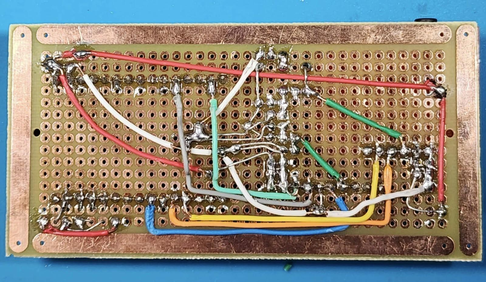
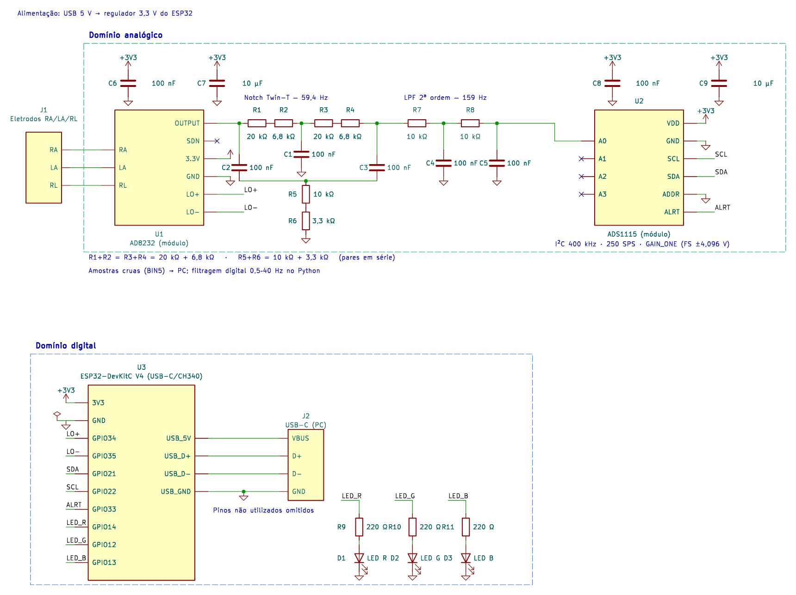

# Hardware do PICMED

O protótipo reúne um ESP32, um módulo AD8232 e um conversor ADS1115 em uma placa de montagem. Esta página registra as fotografias e o esquema elétrico apresentados pelos autores no relato de desenvolvimento do equipamento.

## Placa montada

*Vista superior. O ESP32 está à esquerda, o ADS1115 na parte superior e o AD8232 à direita.*

*Vista inferior, com as soldas e interligações entre os componentes.*

## Esquema elétrico

O sinal dos eletrodos passa pelo AD8232 e pelos filtros analógicos antes de chegar à entrada A0 do ADS1115. Na montagem documentada, o filtro notch Twin-T tem frequência central nominal de 59,4 Hz e o passa-baixa de segunda ordem tem frequência de corte nominal de 159 Hz. Esses valores descrevem o circuito apresentado no relato.

Os módulos são alimentados pela linha de 3,3 V do ESP32. O ADS1115 está configurado no endereço I2C `0x48`, com ganho `GAIN_ONE` e taxa nominal de 250 amostras por segundo. O sinal `ALRT/RDY` informa ao ESP32 quando uma conversão está pronta. As amostras seguem para a aplicação Python por USB serial, a 115200 baud.

## Conexões ao ESP32

| Sinal | GPIO |
|---|---|
| AD8232 `LO+` | 34 |
| AD8232 `LO−` | 35 |
| ADS1115 `SDA` | 21 |
| ADS1115 `SCL` | 22 |
| ADS1115 `ALRT/RDY` | 33 |

O esquema utiliza os pinos de LED da variante `firmware_ecg2.ino`:

| Variante | Vermelho | Verde | Azul |
|---|---|---|---|
| `firmware.ino` (v3.5) | GPIO 4 | GPIO 16 | GPIO 17 |
| `firmware_ecg2.ino` (v3.6) | GPIO 14 | GPIO 12 | GPIO 13 |

Confira a pinagem da placa antes de escolher o firmware. Os cabeçalhos dos arquivos `.ino` indicam “Filtros analógicos: nenhum”; as imagens desta página registram a montagem com filtros externos descrita no documento. A presença desses componentes deve ser conferida no equipamento utilizado.

Consulte a [documentação do firmware](../firmware/README.md) para preparar e gravar o ESP32.

## Origem das imagens

As imagens foram extraídas, sem alterações, do documento fornecido pelo autor:

*Eletrocardiógrafo de código aberto aplicado à extração de VFC em pesquisas no ambiente cirúrgico*, de Vitor Hugo Fernandes Oliveira, Cleiton Caldeira Lopes, Larissa Sestari e Ubirajara José Picanço de Miranda Junior.

Correspondem às figuras 1 (vista superior), 2 (vista inferior) e 3 (esquema elétrico), identificadas no documento como “Elaborado pelos autores”. O arquivo original tem o nome `ELETROCARDIÓGRAFO DE CÓDIGO ABERTO PARA EXTRAÇÃO DE VFC APLICADO AO CONTEXTO CIRÚRGICO.docx`.

[Voltar ao README](../README.md)
